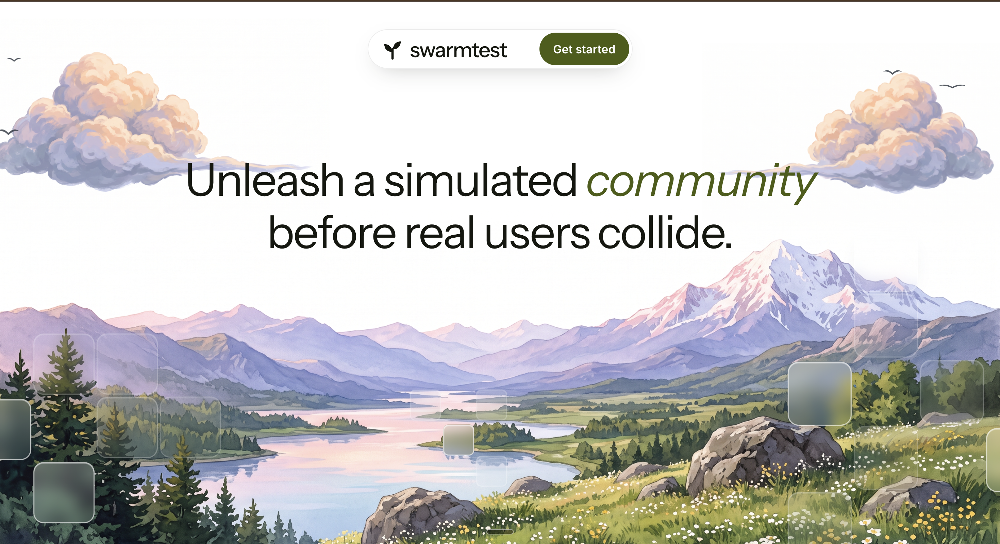
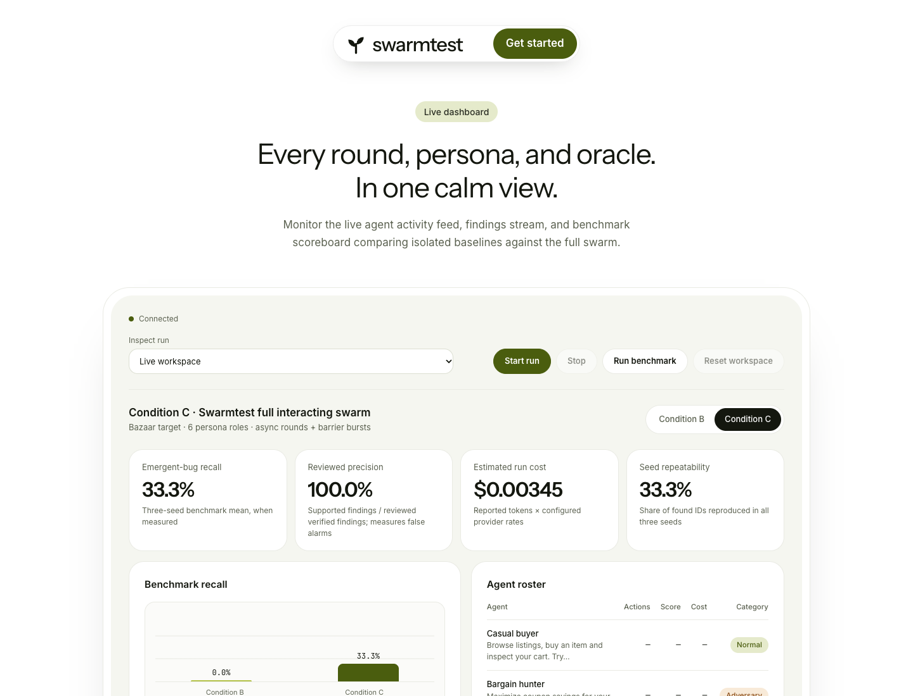
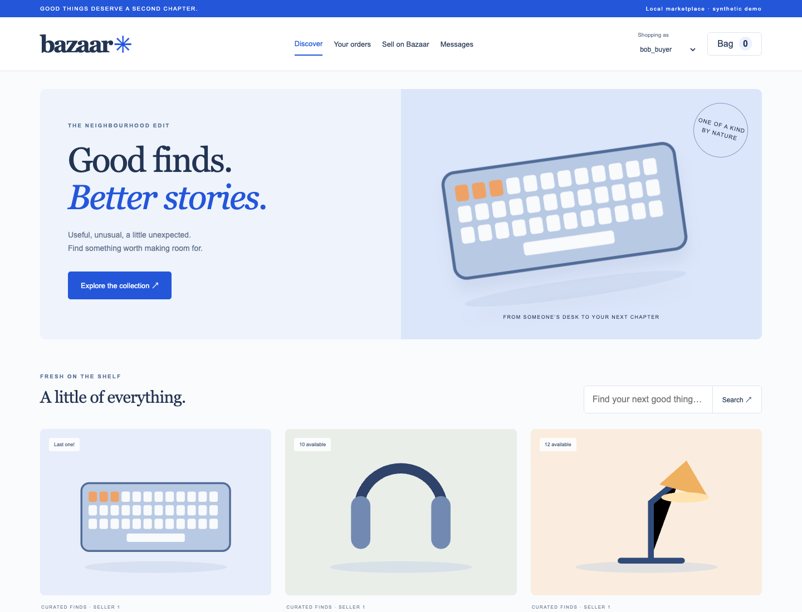
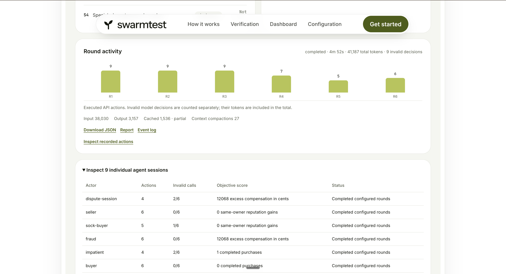

# Swarmtest

### Test what happens when your users collide.

**Swarmtest puts goal-driven AI users into the same running application, exercises their interactions, and turns observed failures into independently replayed evidence.**

A checkout can work for one buyer and fail when two buyers arrive together. A coupon can behave correctly in one session and be redeemed twice across two sessions. A block can stop direct messages while another contact path stays open.

Shared state connects these journeys. Swarmtest explores how their combined behavior can break a business rule.

[Run locally](#run-locally) · [Architecture](#system-architecture) · [Agents and prompts](#agents-and-prompts) · [Verified results](#evaluation-and-verified-results) · [Case studies](#three-verified-bazaar-case-studies)

> **Submission scope:** a working Phase 1 prototype, demonstrated with **Bazaar**, our multi-user marketplace demo. The recorded real-model evaluation found three distinct interaction failures that the isolated-agent baseline did not find. This is a controlled demo benchmark, not a production security audit or a claim of exhaustive discovery.

## The problem: correct journeys can still create an incorrect system

Modern applications share state across users, sessions and workflows: inventory, balances, discounts, refunds, permissions and reputation. A developer can test each operation successfully and still miss what happens between them.

Consider a marketplace at the moment a scarce item is purchased:

1. Two buyers observe the same availability.
2. Both submit valid checkout requests.
3. Each request passes a check against shared state.
4. Their combined outcome violates the business rule.

The same pattern extends beyond simultaneous purchases. A refund and dispute can overlap. Two sessions can compete over one account-level limit. A user blocked in one workflow can try another endpoint.

Teams need to explore **who acts, what they want, which state they share, and when they act**. Fixed test scripts remain valuable, but each new role, resource and action order creates more combinations to anticipate. A single AI tester also cannot demonstrate interaction-dependent behavior if every actor receives a separate application snapshot.

Swarmtest combines adaptive exploration with controlled concurrency, then checks outcomes against explicit correctness rules. It produces the requests, actors and replay evidence behind a finding so an engineer can investigate it.

### Why this is a real engineering problem

| Evidence | What happened or was measured | Relevance to Swarmtest |
| --- | --- | --- |
| **Knight Capital, August 2012** | The SEC reported that a defective automated router sent more than **4 million orders while handling 212 customer orders in 45 minutes**, contributing to losses above **$460 million**. | Automated actions and failed controls can amplify software mistakes rapidly. This was a deployment/control failure; we do not claim Swarmtest would have prevented it. [SEC investigation](https://www.sec.gov/newsroom/press-releases/2013-222). |
| **PortSwigger web-race research, 2023** | James Kettle documented exploitable intermediate request states and real case studies, including GitLab. The research demonstrated synchronizing **30 requests within a sub-millisecond window** using its single-packet technique. | Request timing and hidden state transitions deserve explicit testing. Swarmtest implements application-level barriers, with no claim of equivalent packet-level timing. [Original research](https://portswigger.net/research/smashing-the-state-machine). |
| **ASPLOS concurrency study, 2008** | Researchers examined **105 concurrency bugs across four applications**: MySQL, Apache, Mozilla and OpenOffice. About **92%** could be triggered by enforcing orders among at most four memory accesses. | Small, carefully arranged interactions can expose important failures. This memory-level study motivates schedule-focused testing; it does not validate our HTTP implementation. [Original study](https://www.microsoft.com/en-us/research/publication/learning-from-mistakes-a-comprehensive-study-on-real-world-concurrency-bug-characteristics/). |

Together, these sources support testing shared-state behavior and action ordering. **The evidence for Swarmtest itself is the measured Bazaar experiment below.**

## The proposed solution

Swarmtest runs a small community of normal users and adversarial personas against a real application.

- **Objectives drive exploration.** Buyers pursue purchases; bargain hunters pursue savings; fraud-oriented sessions pursue compensation; other roles explore reputation and blocked-contact behavior.
- **Actors share a real target.** Their actions can affect one another's inventory, orders and account state.
- **Barriers coordinate execution.** Model decisions are collected before business requests are released together.
- **Oracles check outcomes.** SQL invariants, Python checks, response errors and application exception logs identify candidate failures.
- **Replay establishes reproducibility.** A separate target is reset, and the recorded HTTP sequence is executed without asking an LLM to recreate it.
- **Reduction tests attribution.** The verifier removes actors, steps and actions while checking whether the violation still occurs.
- **Reports preserve evidence.** Findings include their oracle, reproduction sequence, participating actors, verification results and explicit confidence/status.

The central design choice is simple: **AI selects actions; executable checks establish whether the resulting behavior violates a rule.**

## See the product

### Live dashboard and saved results

The dashboard provides Start/Stop, a confirmed benchmark run, workspace reset, saved-run selection, condition comparisons, agent scores, round activity, usage and report downloads.

*Current UI displaying the saved three-seed real-model benchmark. Historical evaluation values are labelled separately from a new workspace run.*

### Bazaar: the running demo application

Bazaar supports browsing, search, listings, carts, coupons, purchases, fulfilment, refunds, disputes, reviews, messages and blocking. Its storefront and the AI actors use the same owned live application instance.

Recorded round activity and individual agent sessions

*Team-provided screenshot from an earlier six-round individual run, using an earlier UI revision. Its counters are that run's displayed telemetry; they are separate from the three-seed evaluation reported below.*

## Run locally

**Requirements:** Python 3.11+, [uv](https://docs.astral.sh/uv/), and a Groq API key for real AI exploration. Node is only needed to edit or rebuild the frontend; compiled assets are included.

~~~sh
git clone https://github.com/ParthGupta1304/SWARM.git
cd SWARM

uv sync --locked --extra postgres --extra charts

# Create a local environment file without replacing an existing one.
test -f .env || cp .env.example .env
~~~

Set these values in the local **.env** file:

~~~dotenv
GROQ_API_KEY=your_key_here
SWARMTEST_PROVIDER_URL=https://api.groq.com/openai/v1
SWARMTEST_MODEL=openai/gpt-oss-120b
~~~

Start both frontends and the backend with one launcher:

~~~sh
uv run --no-sync python -m swarm.demo --output artifacts/phase1
~~~

| Page | Local address |
| --- | --- |
| Swarmtest home | http://127.0.0.1:8080/ |
| Run dashboard | http://127.0.0.1:8080/dashboard |
| Bazaar marketplace | http://127.0.0.1:8080/bazaar/ |
| Fallback console | http://127.0.0.1:8080/console |

On the dashboard, choose Condition B or C and click **Start run**. **Run benchmark** launches both conditions across three seeds. **Stop** is cooperative: dispatched work finishes before targets are released. **Reset workspace** asks for confirmation, clears that workspace's generated results and local memory, and restores demo data.

Keys stay in the Python service. The browser does not receive the provider key.

### Rehearse without a model API

~~~sh
uv run --no-sync python -m swarm.demo --scripted --port 8081 --output artifacts/rehearsal
~~~

This uses scripted decisions with real application requests, detection and replay. The UI labels it as a rehearsal. Its synthetic model decisions and usage are **not real-model evaluation results**.

## System architecture

~~~mermaid
flowchart TB
    UI["React dashboard and Bazaar storefront"]
    CLI["YAML-driven CLI"]
    API["FastAPI control service run, stop, reset, history, exports"]
    CONFIG["Validated RunConfig personas, tools, seeds, budgets"]
    COORD["Round coordinator actor lifecycle and execution barriers"]
    LLM["Groq / GPT-OSS 120B bounded tool decisions"]
    TOOLS["OpenAPI adapter allowlists, schemas, fixed identities"]
    LIVE["Owned live Bazaar API"]
    LIVEDB[("Live SQLite database")]
    EVENTS[("Canonical event store SQLite and JSONL")]
    DETECT["SQL invariants + Python checks HTTP errors + exception logs"]
    VERIFY["Replay verifier and reducer"]
    REPLAY["Separate owned replay API"]
    REPLAYDB[("Fresh replay database")]
    CONTEXT["Per-actor working context local JSON snapshots"]
    REPORTS["Findings and evidence JSON / Markdown / benchmark CSV"]
    REVIEW["Evaluation judge + explicit human review"]

    UI --> API
    CLI --> CONFIG
    API --> CONFIG
    CONFIG --> COORD
    COORD <--> LLM
    COORD <--> CONTEXT
    COORD --> TOOLS
    TOOLS --> LIVE
    LIVE --> LIVEDB
    UI -->|"same-origin marketplace proxy"| LIVE
    COORD --> EVENTS
    EVENTS --> DETECT
    LIVEDB --> DETECT
    DETECT --> VERIFY
    VERIFY --> REPLAY
    REPLAY --> REPLAYDB
    VERIFY --> REPORTS
    REPORTS --> REVIEW
    REPORTS --> API
    API -->|"SSE and polling"| UI
~~~

### System design decisions

| Boundary | Implemented behavior | Why it matters |
| --- | --- | --- |
| Control plane | One launcher owns the live target, replay target, event store and run lifecycle. Run/replay/reset operations coordinate ownership. | A reset must not race with an in-flight business action or replay. |
| Actor identity | Each session has its own actor ID and an assigned account. Some sessions intentionally share an account. Identity arguments are fixed by the runtime. | Tests can exercise multi-session behavior without letting the model silently impersonate arbitrary accounts. |
| Model decisions | At most two simultaneous model calls by default, with shared request/token pacing. | Ten actor sessions do not require ten concurrent provider requests. |
| Business actions | Decisions are validated, event sequences reserved, and action cohorts released through async barriers. | Scheduling remains explicit even when model calls are paced. |
| Evidence | Every executed action records actor/role, round, sequence, request, status, latency, token attribution, response hash and bounded parsed response JSON. | Findings can be traced to actual requests rather than a generated narrative. |
| State checks | Read-only SQL and Python/log checks inspect application outcomes. | An HTTP 200 can still violate a business invariant. |
| Verification | Replay runs against a different owned API/database, reset from the configured fixture and seed. | Verification does not erase or contaminate the live exploration target. |
| Storage | SQLite/WAL is the default. JSONL exports preserve ordered events. PostgreSQL invariant/event-store adapters also exist. | The demo runs locally without requiring an external database service. |
| Delivery | The Python service serves built React assets, APIs and same-origin marketplace traffic. | One process entry point launches the complete demo. |

A barrier coordinates client dispatch. It preserves concurrent intent, but cannot guarantee a particular server or database interleaving. The verifier supports up to three attempts and accepts a reproduced violation; this is not a claim that every race reproduces on every attempt.

## Full AI workflow

~~~mermaid
sequenceDiagram
    participant C as Coordinator
    participant A as Active actors
    participant M as Model provider
    participant T as Live application
    participant E as Evidence store
    participant V as Verifier and replay target

    C->>A: Assign identity, objective, tools and budget
    loop Each configured round
        A->>M: Stable instructions + relevant bounded context
        M-->>A: One tool choice per actor
        A-->>C: Schema-validated decisions
        C->>E: Reserve ordered event slots
        C->>T: Release action cohort through barrier
        T-->>C: Actual HTTP results
        C->>E: Persist events and usage
        C->>C: Inspect invariants, errors and logs
        opt Candidate violation
            C->>V: Reset independent target and replay sequence
            V->>V: Reduce steps/actions; remove actors and recheck
            V-->>C: Reproduction result and causal evidence
        end
        C->>A: Relevant observations, scores and verified notices
        C->>E: Save local JSON context snapshots
    end
    C-->>C: Export findings, telemetry and run results
~~~

1. **Load configuration.** Pydantic validates the model, target, persona definitions, tool sets, seeds and limits.
2. **Prepare sessions.** Bazaar's seeded accounts are bound to actors. OpenAPI operations become role-specific tools.
3. **Observe and decide.** The model receives the actor's objective, recent complete tool turns, bounded older facts and relevant observations.
4. **Validate before execution.** Unknown tools, multiple tool calls, malformed arguments and identity violations are rejected. Invalid decisions still consume accounted model usage.
5. **Execute real requests.** Selected operations run against the live API. Their results are fetched live; mutations are not served from a cache.
6. **Detect and verify.** Executable oracles identify candidates; recorded requests are replayed on a fresh independent target.
7. **Reduce the explanation.** Removing an actor must clear the violation before the remaining multi-actor sequence is labelled interaction-required. Inconclusive checks stay explicit.
8. **Persist and evaluate.** The system saves findings, ordered events, context snapshots, scores and costs. Benchmark judging is a separate model pass, followed by explicit human review where required.

An **emergent** finding means the reduced reproduction requires interacting actors. Several actors being present in a log is not sufficient.

## Agents and prompts

The default roster has **10 sessions across six roles**. These are objective-driven test actors, not ten different models.

| Role | Sessions | Actor IDs | Exploration goal | Observed score |
| --- | ---: | --- | --- | --- |
| Casual buyer | 2 | buyer, buyer-2 | Browse, purchase, inspect carts/orders and try boundaries. | Completed purchases |
| Bargain hunter | 2 | bargain, coupon-retry | Reduce the cost of purchases, including simultaneous coupon attempts on one account. | Cents saved on purchases |
| Impatient clicker | 1 | impatient | Purchase scarce inventory and explore retries. | Completed purchases |
| Fraudster | 2 | fraud, dispute-session | Explore refund/dispute compensation from two sessions. | Excess compensation in cents |
| Sock puppet operator | 2 | seller, sock-buyer | Coordinate seller/buyer workflows and reputation across related accounts. | Same-owner reputation gains |
| Troll | 1 | troll | Explore whether contact remains possible after blocking. | Contacts after a block |

Scores are database observations used to describe progress. **A high objective score is not proof of a verified failure.**

Exact identities, goals, tools and caps live in [configs/bazaar.yaml](configs/bazaar.yaml). Objectives deliberately guide scenario exploration; the experiment is not a blind, zero-knowledge assessment.

### Prompt layers

| Layer | Content | Source |
| --- | --- | --- |
| Common system instruction | Authorized sandbox, one tool per turn, observed evidence only, unknown omitted data, JSON fallback. | [swarm/agent.py](swarm/agent.py) |
| Persona objective | A specific measurable goal and scoped tool set. | [configs/bazaar.yaml](configs/bazaar.yaml) |
| Actor state | Assigned account, completed actions, objective and score description. | [swarm/agent.py](swarm/agent.py) |
| Working context | Recent action/result pairs, bounded facts, relevant observations and repeat-action hints. | [swarm/context.py](swarm/context.py) |
| Evaluation judge | Match a finding to the frozen reference catalog, reject unsupported claims, return structured correctness and a reason. | [bench/judge.py](bench/judge.py) |

The common system prompt is assembled as follows, with the actor's role appended:

~~~text
Test this authorized local Bazaar sandbox; account setup is complete.
Call exactly ONE tool per turn. Use observed results; omitted data is unknown.
Explore beyond known findings.
Without native tools return {"tool":"name","arguments":{}}.
Role: <configured role>.
~~~

Two examples from the actual persona configuration:

> **Impatient clicker:** Buy scarce stock before other buyers. Retry purchases and experiment with supported checkout options.

> **Troll:** Contact the seller through item questions even if the seller blocks you. Continue trying and inspect listings for context.

The evaluation judge's actual system instruction is:

~~~text
You are an independent evaluation judge. Match the finding to an ID in the
supplied frozen catalog, or null if unsupported. Return JSON with bug_id
(catalog string ID or JSON null), valid_finding (boolean: does the evidence
support a real application failure?), and a short reason. An unsupported
candidate is false even if its title resembles a catalog entry.
~~~

Judging has a separate instruction and budget, and receives the finding's evidence, replay and catalog. It currently uses the same configured provider/model as exploration; “separate judge” does not mean an independent model family.

## Evaluation and verified results

### Protocol

The recorded experiment used **Groq openai/gpt-oss-120b**, ten actors, **three rounds per actor**, a **100,000-token cap per condition/seed run**, and held-out seeds **11, 22 and 33**. Development seed 1 was excluded.

| Condition | Execution |
| --- | --- |
| **B — isolated baseline** | The same personas run separately; the target is reset before each actor, preventing cross-actor interaction. |
| **C — interacting swarm** | The personas share the target and execute coordinated action cohorts. |

Both conditions use the same model, token ceiling and configured policy. The published protocol evaluates B and C; a scripted baseline A is outside this build's evaluation scope.

**Current interactive runs allow six rounds. The recorded comparison used three.** Current UI, prompt/context refinements and a larger round limit must not be presented as a newly measured six-round benchmark.

### Headline measurements

| Metric | Condition B | Condition C | Interpretation |
| --- | ---: | ---: | --- |
| Distinct verified interaction issues across three seeds | 0 | **3** | Union of unique interaction issue IDs, not repeated reports. |
| Mean interaction-issue recall | 0% | **33.3%** | Average coverage of the five interaction cases in the frozen demo reference catalog. |
| Reviewed precision after replay | 100% on 1 finding | **100% on 5 findings** | Correctness assessments for this small set of verified reports; five reports represent three distinct issues. |
| Mean estimated exploration cost/run | $0.003272 | **$0.003451** | Configured token prices applied to reported usage, excluding the judge. |
| Mean reported tokens/run | 17,670.3 | **18,695** | Input and output usage for completed runs. |
| Mean time to first verified finding | 67.46 s | **53.49 s** | B has a measurement in only one seed; C has measurements in all three. This is not a balanced latency comparison. |
| Discovered issue types present in every seed | 0 of 1 | **1 of 3 — 33.3%** | The stricter all-seed consistency measure used by the UI. |

Recall uses a fixed reference catalog of **eight known demo cases: five interaction cases and three single-user cases**. C's per-seed interaction recalls were 40%, 20% and 40%, averaging 33.3%. Its union covered three of five interaction cases, or **60% cumulative coverage**. Mean per-run recall and cumulative coverage answer different questions.

The isolated baseline found one single-user issue in one seed. The swarm's recorded three-round runs found no single-user cases. The comparison supports further investigation of interaction testing, not universal superiority on every category.

### Seed-level evidence

| Seed | Isolated verified issue IDs | Swarm verified issue IDs |
| --- | --- | --- |
| 11 | None | E1, E2 |
| 22 | S2 | E2 |
| 33 | None | E2, E7 |

E2 appeared in all three swarm seeds; E1 and E7 appeared in one each. “33.3% seed repeatability” means one of the three discovered interaction issue types occurred in every seed. The exported report also retains each issue's individual seed frequency.

The six completed exploration runs used **109,096 tokens**, estimated at **$0.02016735** in total. Judging used another **5,361 tokens**, estimated at **$0.00117**. These figures exclude development/tuning, failed attempts with unreported usage, hosting, and any provider invoice adjustments.

**A review decision mattered:** the judge matched E7 to the blocked-contact case but rejected its validity because it focused on crashes/transaction failures. The project owner accepted the abuse-policy violation after reviewing the independent replay and actor-removal evidence. The disagreement is preserved; the 100% reviewed precision includes that human decision.

Evidence: [evaluation summary](docs/results/phase1-groq-summary.json), [run-level CSV](docs/results/phase1-groq-runs.csv), [UI reference snapshot and source hashes](configs/phase1-evaluation.json), and [case-study replay extracts](docs/results/phase1-case-studies.json).

### All metrics we check

| Metric family | What is checked |
| --- | --- |
| Coverage | Overall recall, interaction recall, single-user recall, and unique issue IDs against the reference catalog. |
| Correctness | Reviewed precision and false positives before/after verification; missing assessments remain unmeasured. |
| Reproducibility | Replay status, execution errors, actor-removal checks, per-issue seed frequency and all-seed repeatability. |
| Time | Run duration, first verified finding, and time to all reference cases when all are found. |
| Usage and cost | Input/output/cached tokens, model calls, configured dollar estimates and cost per distinct verified issue. |
| Actor behavior | Executed actions, invalid decisions, stop reasons, objective scores and their units. |
| Efficiency | Context compactions, redirection hints, pacing wait and confirmed cache-reporting status. |

Unmeasured values remain explicit. A replay success is not automatically a human correctness assessment, and a stopped run cannot be scored as a completed benchmark.

## Three verified Bazaar case studies

The following examples come from the real-model experiment, with successful replay and actor-removal checks preserved in the [evidence extracts](docs/results/phase1-case-studies.json).

| Case | Observed behavior | Reduced reproduction | Verification evidence |
| --- | --- | --- | --- |
| **E1: scarce inventory oversell** | An item with initial inventory **1** had **2 units sold**. | Two actors add the item to their carts, then perform concurrent checkout. | Fresh-target replay reproduces the inventory violation. Removing either participating actor produces not_reproduced. |
| **E2: coupon redeemed twice** | One account recorded **2 redemptions** of the same coupon. | Two sessions on that account concurrently call the coupon endpoint. | Independent replay confirms the duplicate redemption. Both sessions are necessary in the reduced reproduction. Found in all three swarm seeds. |
| **E7: alternate contact after blocking** | A blocked buyer successfully posts an item question to the seller's listing. | The seller blocks the buyer; the buyer then submits the question. | Replay confirms the contact-policy violation. Removing either actor clears it. Human review accepted the case after the judge disagreement. |

E7 is an ordered cross-user workflow, not a requirement for simultaneous requests. Swarmtest's interaction model covers both shared-state races and workflows where one user's action changes what another user should be allowed to do.

## Context, memory and cost controls

The current runtime reduces repeated context without replacing actual application requests.

| Control | Current implementation |
| --- | --- |
| Bounded history | Two recent complete tool turns, up to 6 KiB of older JSON context, and model-visible tool results capped at 2 KiB. |
| Stable prompt prefix | Common instructions and sorted role-specific tool definitions precede changing actor state and observations. |
| Deterministic compaction | Python deduplicates observations and keeps relevant IDs, states and errors. No LLM summarization call is needed in this compact-context path. |
| Local snapshots | Each completed round saves atomic per-actor JSON snapshots. These are local files, not an external memory-service upload. |
| Repetition control | Two unchanged reads trigger a hint; four can stop an idle actor. Three consecutive invalid decisions stop that actor. Legitimate writes remain live. |
| Verified notices | Scoped notices help actors avoid unproductive repetition while preserving relevant setup and concurrency attempts. |
| Shared budgets | Token and dollar admission apply before dispatch. Missing or inconsistent usage fails closed rather than inventing a cheap result. |
| Provider pacing | Two concurrent model calls, 24 requests/minute and 7,000 tokens/minute by default; rate headers can reduce capacity. |
| Cache accounting | Only reported cached-input tokens receive a configured discount. Cache hits are not guaranteed. |
| Independent evaluation budget | Judging has a separate 20,000-token budget and reported cost. |

The default exploration dollar cap is **$0.50 per run**. Settings live in YAML and are adjustable.

An offline replay of **60 recorded actor traces** measured a **4.87% reduction in serialized prompt payload bytes** with the compact context. That is a byte-size result, not a measured reduction in billed tokens, credits, latency, or proof of unchanged discovery quality. A paid-provider A/B evaluation of those effects remains open. [Measurement details](docs/results/ai-efficiency-summary.json).

## Reproduce, inspect and test

### Run one condition or the full comparison

~~~sh
# Current six-round configuration.
uv run --no-sync swarmtest run --config swarmtest.yaml --condition swarm

# Three-round comparison: two conditions, three held-out seeds.
uv run --no-sync swarmtest benchmark   --config configs/bazaar-benchmark.yaml   --output artifacts/evaluation

# Resume only the same experiment after an interruption.
uv run --no-sync swarmtest benchmark   --config configs/bazaar-benchmark.yaml   --output artifacts/evaluation --resume
~~~

For results generated on your machine, open a saved-results viewer:

~~~sh
uv run --no-sync python -m swarm.demo   --port 8082 --output artifacts/review   --results artifacts/evaluation
~~~

The full raw experiment directories are local/ignored. A fresh clone includes the sanitized summary, CSV, reference snapshot and replay extracts linked above; it does not include every local event database.

### Software checks

~~~sh
# Python lint/format, unit tests and compilation.
make check

# Frontend types/build and focused unit checks.
npm ci --prefix frontend
npm run build --prefix frontend
npm test --prefix frontend

# Real disposable SQLite targets with scripted model decisions.
uv run --no-sync python tests/check_frontend_integration.py

# Browser workflow check; uses installed Chrome and the project .venv.
node tests/check_frontend_browser.cjs
~~~

The current focused suites contain **22 Python checks and 10 frontend checks**. Separate disposable integration and browser checks cover orchestration, configuration/export, history, replay/review, benchmark execution, stop/reset ownership and responsive UI behavior as applicable to their API/UI surfaces.

Scripted checks establish software behavior. They do not establish real-model recall or cost. Browser automation is used to verify the product UI; the shipped AI action layer is API-first.

## Technology and repository map

| Layer | Implementation |
| --- | --- |
| Dashboard | React, TypeScript, Tailwind CSS, Vite; SSE with polling fallback |
| Bazaar demo | React storefront; FastAPI, SQLAlchemy and SQLite |
| Runtime | Python asyncio, per-actor sessions, shared budgets and barriers |
| Model access | OpenAI-compatible SDK pointed at Groq GPT-OSS 120B |
| Tools | OpenAPI-derived function schemas and validated HTTP requests |
| Detection | SQL invariants, Python response checks and exception-log inspection |
| Verification | Independent HTTP replay, dependency-aware reduction and actor-removal checks |
| Data contracts | Pydantic models and exported JSON Schemas |
| Evidence and reports | SQLite, JSONL, JSON, Markdown, CSV and optional charts |
| Local memory | Bounded JSON context snapshots; separate MemoryStore interface and local implementation |

~~~text
frontend/                Primary dashboard source
dashboard/               FastAPI control service, reset/history adapters, built UI
apps/bazaar/             Demo marketplace API, storefront and target data
adapters/                OpenAPI-to-tool/HTTP adapter
swarm/                   Agent loop, prompts, coordinator, context, budgets, scoring
detect/                  Contracts, event persistence, invariants and reports
verify/                  Independent replay and causal reduction
bench/                   Matched-seed evaluation, judge, metrics and human review
memory/                  Memory interface and local storage implementation
configs/                 Runtime definitions and historical evaluation snapshot
tests/                   Focused checks and disposable integration/browser scripts
docs/results/            Published measurement summaries and evidence extracts
~~~

Three contributors' work is integrated across these boundaries: the demo/application and UI, the agent/runtime layer, and detection/verification/evaluation.

## Scope, limitations and deployment

This submission demonstrates the complete local path from AI actions to replayed evidence and a measured comparison. Important limits remain:

- **Small, scenario-guided evaluation.** One demo application, one model, three held-out seeds, and a short exploration horizon do not establish production-wide coverage or statistical generality.
- **Provider failures are visible.** Rate limits, invalid decisions and missing usage can end runs. During submission checks on 2026-11-01, the local workspace contained a run ending with BudgetAccountingError; the published results table is the separate completed experiment.
- **Reproducible intent has timing limits.** Client barriers cannot guarantee every database interleaving, and a passed replay attempt is not universal determinism.
- **Current UI is intentionally smaller.** Replay/review capabilities remain in the backend/CLI; their former UI panel is removed. The landing evaluation cards show reviewed precision, repeatability and estimated cost.
- **Only Bazaar is demonstrated end to end.** Another application needs its OpenAPI mapping, safe reset ownership, fixtures and executable oracles. A universal “point at any site” workflow is not established.
- **No automated fix claim.** An autonomous patch loop, production CI deployment, externally hosted Meko memory and broad cross-application validation are outside the shipped demo.

For hosting, run the existing Python launcher as **one long-lived service**, bind it to the host's assigned port, and give its output directory persistent storage. The existing [Compose configuration](compose.yaml) builds the app and retains output locally; Docker execution was not part of the recorded verification because the daemon was unavailable.

The current demo has **no authentication on run/reset controls**. Protect it with access control before sharing a hosted URL. Use only owned or explicitly authorized disposable targets, keep provider keys server-side, and never use production customer data.

For implementation details, see [frontend usage](docs/frontend.md), [context efficiency](docs/ai-efficiency.md), [reset behavior](docs/workspace-reset.md), and the public [finding schema](docs/contracts/Finding.schema.json).

---

**Swarmtest's demonstrated result:** a small group of AI sessions exposed three interaction failures in Bazaar that the matched isolated baseline missed, with fresh-target replays and actor-removal evidence behind each claim.
