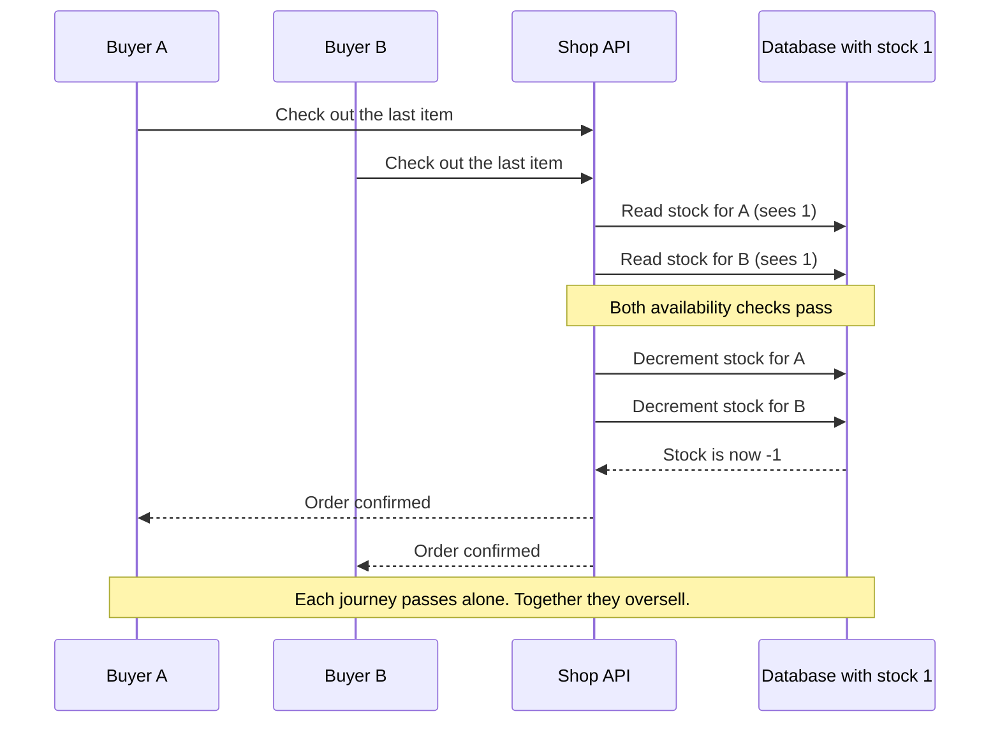
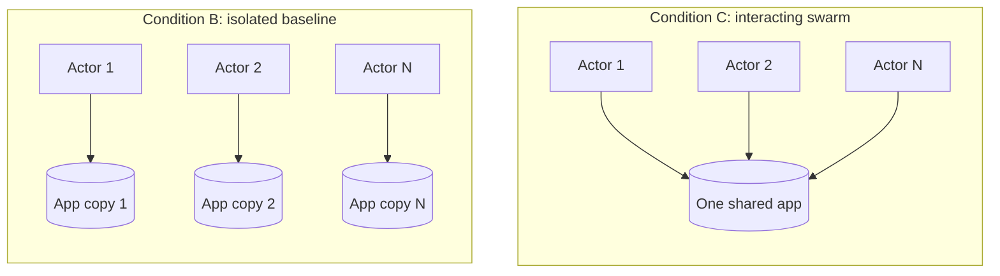
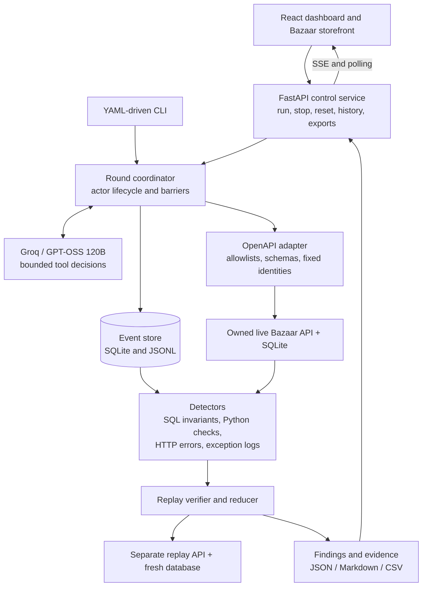
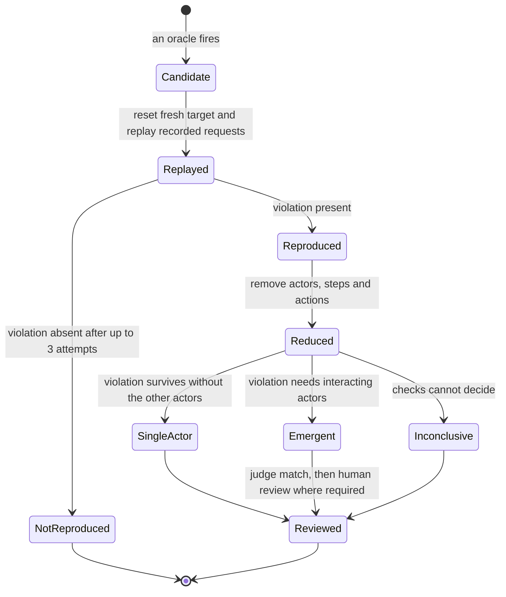
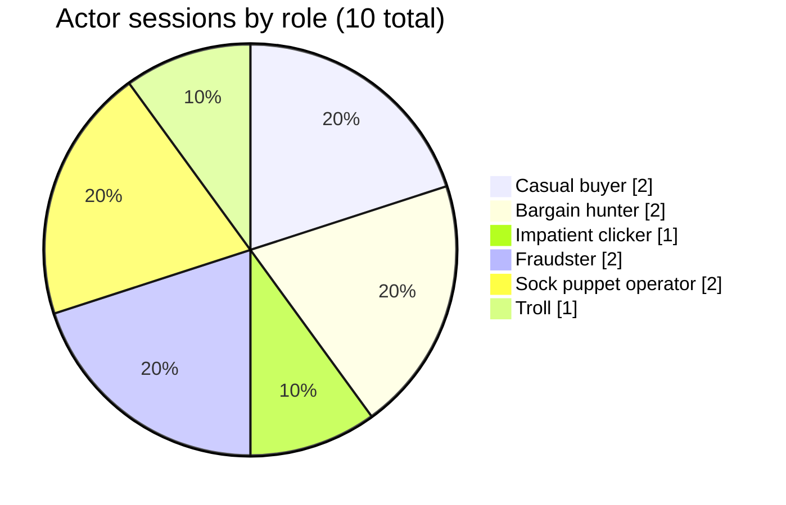
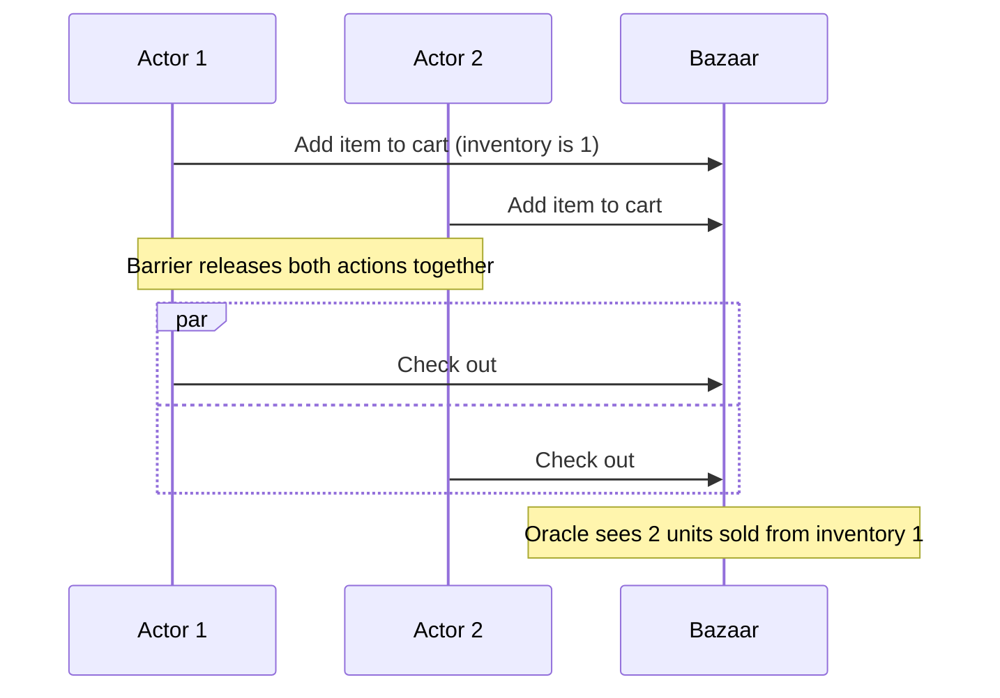
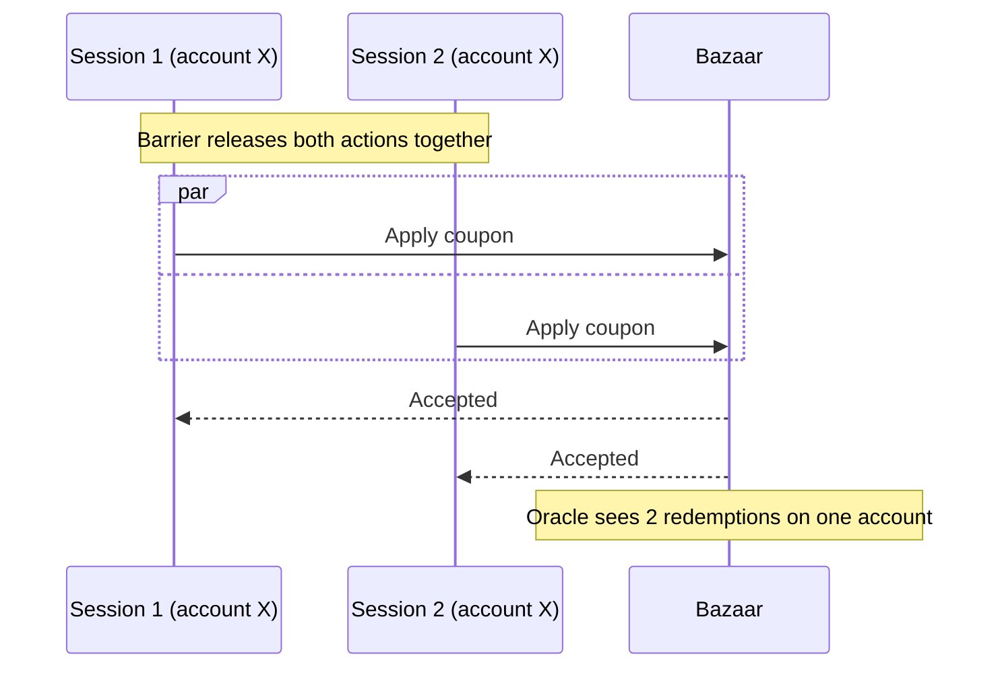
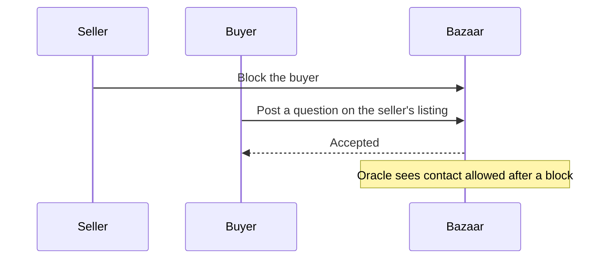

# Swarmtest

### Test what happens when your users collide.

**Swarmtest puts goal-driven AI users into the same running application, exercises their interactions, and turns observed failures into independently replayed evidence.**

A checkout can work for one buyer and fail when two buyers arrive together. A coupon can behave correctly in one session and be redeemed twice across two sessions. A block can stop direct messages while another contact path stays open. Shared state connects these journeys, and Swarmtest explores how their combined behavior can break a business rule.

[Results](#results-at-a-glance) · [How it works](#how-it-works) · [Run locally](#run-locally) · [Agents and prompts](#agents-and-prompts) · [Evaluation](#evaluation-details) · [Case studies](#three-verified-bazaar-case-studies) · [Limitations](#scope-limitations-and-deployment)


> **Submission scope:** a working Phase 1 prototype, demonstrated with **Bazaar**, our multi-user marketplace demo. The recorded real-model evaluation found three distinct interaction failures that the isolated-agent baseline did not find. This is a controlled demo benchmark, not a production security audit or a claim of exhaustive discovery.

## Results at a glance

Recorded experiment: Groq `openai/gpt-oss-120b`, 10 actors, 3 rounds each, held-out seeds 11, 22 and 33.

| Metric | Isolated baseline (B) | Interacting swarm (C) |
| --- | ---: | ---: |
| Distinct verified interaction issues (3 seeds) | 0 | **3** (E1, E2, E7) |
| Mean interaction-issue recall | 0% | **33.3%** (60% cumulative coverage) |
| Reviewed precision after replay | 100% on 1 finding | **100% on 5 findings** |
| Mean estimated exploration cost per run | $0.003272 | **$0.003451** |

The baseline found one single-user issue (S2) in one seed. The swarm found no single-user issues in these three-round runs. The comparison supports further investigation of interaction testing, not superiority on every bug category. Full protocol, caveats and per-seed results are in [Evaluation details](#evaluation-details).


## The problem: correct journeys can still create an incorrect system

Modern applications share state across users and sessions: inventory, balances, discounts, refunds, permissions and reputation. Each operation can pass its own test and the system can still break between operations. Take a scarce item:

1. Two buyers observe the same availability.
2. Both submit valid checkout requests.
3. Each request passes a check against shared state.
4. Their combined outcome violates the business rule.



The pattern extends beyond simultaneous purchases. A refund and a dispute can overlap. Two sessions can compete over one account-level limit. A user blocked in one workflow can try another endpoint.

Fixed scripts stay valuable, but every new role, resource and action order multiplies the combinations to anticipate. A single AI tester cannot show interaction-dependent behavior if each actor gets a separate application snapshot. Swarmtest combines adaptive exploration with controlled concurrency, then checks outcomes against explicit correctness rules.

### Why this is a real engineering problem

| Evidence | What was reported | Relevance to Swarmtest |
| --- | --- | --- |
| **Knight Capital, 2012** | The SEC reported a defective automated router sent more than 4 million orders while handling 212 customer orders in 45 minutes, contributing to losses above $460 million. | Failed controls can amplify software mistakes quickly. This was a deployment/control failure; we do not claim Swarmtest would have prevented it. [SEC](https://www.sec.gov/newsroom/press-releases/2013-222) |
| **PortSwigger web-race research, 2023** | James Kettle documented exploitable intermediate request states, including a GitLab case, and a single-packet technique that synchronizes 20–30 requests to arrive within about a millisecond. | Request timing and hidden state transitions deserve explicit testing. Swarmtest uses application-level barriers, not packet-level timing. [Research](https://portswigger.net/research/smashing-the-state-machine) |
| **ASPLOS concurrency study, 2008** | 105 concurrency bugs across MySQL, Apache, Mozilla and OpenOffice; about 92% could be triggered by enforcing orders among at most four memory accesses. | Small, carefully arranged interactions can expose serious failures. A memory-level study; it does not validate our HTTP implementation. [Study](https://www.microsoft.com/en-us/research/publication/learning-from-mistakes-a-comprehensive-study-on-real-world-concurrency-bug-characteristics/) |

These sources support testing shared-state behavior and action ordering. **The evidence for Swarmtest itself is the measured Bazaar experiment.**

## How it works

Swarmtest runs a small community of normal and adversarial personas against a real application.

- **Objectives drive exploration.** Buyers buy, bargain hunters chase savings, fraud-oriented sessions chase compensation, others probe reputation and blocked-contact behavior.
- **Actors share a real target,** so their actions affect one another's inventory, orders and account state.
- **Barriers coordinate execution.** Model decisions are collected first, then business requests are released together.
- **Oracles check outcomes.** SQL invariants, Python checks, response errors and exception logs flag candidate failures.
- **Replay establishes reproducibility.** A separate target is reset and the recorded HTTP sequence is replayed without asking an LLM to recreate it.
- **Reduction tests attribution.** The verifier removes actors, steps and actions and checks whether the violation survives.
- **Reports preserve evidence:** oracle, reproduction sequence, participating actors, verification results and explicit status.

The central design choice: **AI selects actions; executable checks decide whether a rule was violated.**

An **emergent** finding means the reduced reproduction requires interacting actors. Several actors appearing in a log is not enough.

### What the comparison actually changes

The two conditions use the same personas, model and token cap. The only difference is whether actors can affect one another.



In B, the target is reset before each actor, so no actor can see or change another's state. In C, actors share inventory, orders, coupons and block lists, and barriers release their actions together.

### Architecture



### Key design decisions

| Boundary | Implemented behavior | Why it matters |
| --- | --- | --- |
| Control plane | One launcher owns the live target, replay target, event store and run lifecycle. | A reset must not race with an in-flight action or replay. |
| Actor identity | Each session has its own actor ID and assigned account; identity arguments are fixed by the runtime. Some sessions intentionally share an account. | Multi-session behavior can be tested without the model impersonating arbitrary accounts. |
| Model decisions | At most two simultaneous model calls by default, with shared request/token pacing. | Ten actors do not need ten concurrent provider requests. |
| Business actions | Decisions are validated, event slots reserved, and action cohorts released through async barriers. | Scheduling stays explicit even when model calls are paced. |
| Evidence | Every action records actor, role, round, sequence, request, status, latency, token attribution, response hash and bounded response JSON. | Findings trace to real requests, not a generated narrative. |
| Verification | Replay runs against a different owned API and database, reset from the configured fixture and seed. | Verification never contaminates the live exploration target. |
| Storage | SQLite/WAL by default, JSONL exports, and PostgreSQL adapters. | The demo runs locally with no external database. |

A barrier coordinates client dispatch. It preserves concurrent intent but cannot guarantee a particular server or database interleaving. The verifier allows up to three attempts and accepts a reproduced violation; this is not a claim that every race reproduces every time.

### Per-round workflow

1. **Load configuration.** Pydantic validates the model, target, personas, tool sets, seeds and limits.
2. **Prepare sessions.** Seeded accounts are bound to actors; OpenAPI operations become role-specific tools.
3. **Observe and decide.** Each actor gets its objective, recent complete tool turns, bounded older facts and relevant observations.
4. **Validate.** Unknown tools, multiple tool calls, malformed arguments and identity violations are rejected. Invalid decisions still count toward model usage.
5. **Execute** real requests against the live API. Results are never served from a cache.
6. **Detect and verify.** Oracles flag candidates; recorded requests are replayed on a fresh target.
7. **Reduce.** Removing an actor must clear the violation before the sequence is labelled interaction-required. Inconclusive checks stay explicit.
8. **Persist and evaluate.** Findings, events, context snapshots, scores and costs are saved. Benchmark judging is a separate model pass, followed by human review where required.

### Life of a finding



Only reproduced findings are reported as verified. Anything that fails replay or reduction stays labelled as such rather than being dropped or promoted.

## See the product

### Live dashboard and saved results

Start/Stop, a confirmed benchmark run, workspace reset, saved-run selection, condition comparisons, agent scores, round activity, usage and report downloads.


*Current UI showing the saved three-seed real-model benchmark. Historical evaluation values are labelled separately from a new workspace run.*

### Bazaar: the demo application

Browsing, search, listings, carts, coupons, purchases, fulfilment, refunds, disputes, reviews, messages and blocking. The storefront and the AI actors use the same owned live instance.


<details>
<summary>Recorded round activity and individual agent sessions</summary>


*Screenshot from an earlier six-round individual run, using an earlier UI revision. Its counters are that run's own telemetry, separate from the three-seed evaluation below.*

</details>

## Run locally

**Requirements:** Python 3.11+, [uv](https://docs.astral.sh/uv/), and a Groq API key for real AI exploration. Node is only needed to rebuild the frontend; compiled assets are included.

```sh
git clone https://github.com/ParthGupta1304/SWARM.git
cd SWARM

uv sync --locked --extra postgres --extra charts

# Create a local environment file without replacing an existing one.
test -f .env || cp .env.example .env
```

Set these values in `.env`:

```dotenv
GROQ_API_KEY=your_key_here
SWARMTEST_PROVIDER_URL=https://api.groq.com/openai/v1
SWARMTEST_MODEL=openai/gpt-oss-120b
```

Start both frontends and the backend with one launcher:

```sh
uv run --no-sync python -m swarm.demo --output artifacts/phase1
```

| Page | Local address |
| --- | --- |
| Swarmtest home | http://127.0.0.1:8080/ |
| Run dashboard | http://127.0.0.1:8080/dashboard |
| Bazaar marketplace | http://127.0.0.1:8080/bazaar/ |
| Fallback console | http://127.0.0.1:8080/console |

On the dashboard, choose Condition B or C and click **Start run**. **Run benchmark** launches both conditions across three seeds. **Stop** is cooperative: dispatched work finishes before targets are released. **Reset workspace** asks for confirmation, clears that workspace's generated results and local memory, and restores demo data. Keys stay in the Python service; the browser never receives the provider key.

### Rehearse without a model API

```sh
uv run --no-sync python -m swarm.demo --scripted --port 8081 --output artifacts/rehearsal
```

This uses scripted decisions with real application requests, detection and replay. The UI labels it as a rehearsal. Its synthetic decisions and usage are **not real-model evaluation results**.

## Agents and prompts

The default roster has **10 sessions across six roles**. They are objective-driven test actors, not ten different models.



| Role | Sessions | Actor IDs | Exploration goal | Observed score |
| --- | ---: | --- | --- | --- |
| Casual buyer | 2 | buyer, buyer-2 | Browse, purchase, inspect carts/orders, try boundaries. | Completed purchases |
| Bargain hunter | 2 | bargain, coupon-retry | Reduce purchase cost, including simultaneous coupon attempts on one account. | Cents saved |
| Impatient clicker | 1 | impatient | Buy scarce inventory and explore retries. | Completed purchases |
| Fraudster | 2 | fraud, dispute-session | Explore refund/dispute compensation from two sessions. | Excess compensation (cents) |
| Sock puppet operator | 2 | seller, sock-buyer | Coordinate seller/buyer workflows and reputation across related accounts. | Same-owner reputation gains |
| Troll | 1 | troll | Test whether contact remains possible after blocking. | Contacts after a block |

Scores are database observations that describe progress. **A high objective score is not proof of a verified failure.** Exact identities, goals, tools and caps live in [configs/bazaar.yaml](configs/bazaar.yaml). Objectives deliberately guide scenario exploration; this is not a blind, zero-knowledge assessment.

### Prompt layers

| Layer | Content | Source |
| --- | --- | --- |
| Common system instruction | Authorized sandbox, one tool per turn, observed evidence only, JSON fallback. | [swarm/agent.py](swarm/agent.py) |
| Persona objective | A measurable goal and scoped tool set. | [configs/bazaar.yaml](configs/bazaar.yaml) |
| Actor state | Assigned account, completed actions, objective and score description. | [swarm/agent.py](swarm/agent.py) |
| Working context | Recent action/result pairs, bounded facts, relevant observations, repeat-action hints. | [swarm/context.py](swarm/context.py) |
| Evaluation judge | Match a finding to the frozen catalog, reject unsupported claims, return correctness and a reason. | [bench/judge.py](bench/judge.py) |

Common system prompt, with the actor's role appended:

```text
Test this authorized local Bazaar sandbox; account setup is complete.
Call exactly ONE tool per turn. Use observed results; omitted data is unknown.
Explore beyond known findings.
Without native tools return {"tool":"name","arguments":{}}.
Role: <configured role>.
```

Current Groq GPT-OSS runs extend this with explicit one-object JSON instructions and the permitted action schemas. JSON object mode avoids a native tool-call formatting failure seen during submission checks; every action still passes local schema, tool and identity checks. The historical three-seed benchmark predates this change. See [provider errors and key rotation](docs/provider-errors.md).

Two examples from the persona configuration:

> **Impatient clicker:** Buy scarce stock before other buyers. Retry purchases and experiment with supported checkout options.

> **Troll:** Contact the seller through item questions even if the seller blocks you. Continue trying and inspect listings for context.

The evaluation judge's system instruction:

```text
You are an independent evaluation judge. Match the finding to an ID in the
supplied frozen catalog, or null if unsupported. Return JSON with bug_id
(catalog string ID or JSON null), valid_finding (boolean: does the evidence
support a real application failure?), and a short reason. An unsupported
candidate is false even if its title resembles a catalog entry.
```

Judging has its own instruction and budget, and receives the finding's evidence, replay and catalog. It uses the same provider and model as exploration, so "separate judge" does not mean an independent model family.

## Evaluation details

### Protocol

Groq `openai/gpt-oss-120b`, ten actors, **three rounds per actor**, a **100,000-token cap per condition/seed run**, held-out seeds **11, 22 and 33**. Development seed 1 was excluded.

| Condition | Execution |
| --- | --- |
| **B: isolated baseline** | The same personas run separately; the target is reset before each actor, preventing cross-actor interaction. |
| **C: interacting swarm** | Personas share the target and execute coordinated action cohorts. |

Both conditions use the same model, token ceiling and policy. A scripted baseline A is outside this build's scope. **Current interactive runs allow six rounds; the recorded comparison used three.** The current UI and prompt/context refinements must not be presented as a newly measured six-round benchmark.

### Headline measurements

| Metric | B | C | Interpretation |
| --- | ---: | ---: | --- |
| Distinct verified interaction issues, 3 seeds | 0 | **3** | Union of unique issue IDs, not repeated reports. |
| Mean interaction-issue recall | 0% | **33.3%** | Average coverage of the five interaction cases in the frozen reference catalog. |
| Reviewed precision after replay | 100% on 1 finding | **100% on 5 findings** | Five reports represent three distinct issues. |
| Mean estimated cost per run | $0.003272 | **$0.003451** | Configured token prices on reported usage, excluding the judge. |
| Mean reported tokens per run | 17,670.3 | **18,695** | Input and output usage for completed runs. |
| Mean time to first verified finding | 67.46 s | **53.49 s** | B has a measurement in only one seed; C in all three. Not a balanced latency comparison. |
| Issue types present in every seed | 0 of 1 | **1 of 3 (33.3%)** | The stricter all-seed consistency measure used by the UI. |

The reference catalog has **eight known demo cases: five interaction and three single-user.** C's per-seed interaction recalls were 40%, 20% and 40% (mean 33.3%). Its union covered three of five, or **60% cumulative coverage**. Mean per-run recall and cumulative coverage answer different questions.


### Seed-level evidence

| Seed | Isolated verified issue IDs | Swarm verified issue IDs |
| --- | --- | --- |
| 11 | None | E1, E2 |
| 22 | S2 | E2 |
| 33 | None | E2, E7 |

E2 appeared in all three swarm seeds; E1 and E7 in one each. "33.3% seed repeatability" means one of the three discovered issue types occurred in every seed. The exported report keeps each issue's individual seed frequency.

The six completed exploration runs used **109,096 tokens** (about **$0.02016735**). Judging used another **5,361 tokens** (about **$0.00117**). These figures exclude development/tuning, failed attempts with unreported usage, hosting and provider invoice adjustments.

**A review decision mattered:** the judge matched E7 to the blocked-contact case but rejected its validity because it focused on crashes and transaction failures. The project owner accepted the abuse-policy violation after reviewing the independent replay and actor-removal evidence. The disagreement is preserved, and the 100% reviewed precision includes that human decision.

Evidence: [evaluation summary](docs/results/phase1-groq-summary.json) · [run-level CSV](docs/results/phase1-groq-runs.csv) · [reference snapshot and source hashes](configs/phase1-evaluation.json) · [case-study replay extracts](docs/results/phase1-case-studies.json)

### Metrics tracked

Coverage (overall, interaction, single-user recall); correctness (reviewed precision, false positives before/after verification); reproducibility (replay status, actor-removal checks, per-issue and all-seed frequency); time (run duration, first verified finding); usage and cost (tokens, model calls, dollar estimates, cost per distinct verified issue); actor behavior (actions, invalid decisions, stop reasons, scores); efficiency (context compactions, redirection hints, pacing wait, cache-reporting status). Unmeasured values stay explicit, and a stopped run cannot be scored as a completed benchmark.

## Three verified Bazaar case studies

From the real-model experiment, with replay and actor-removal checks preserved in the [evidence extracts](docs/results/phase1-case-studies.json).

| Case | Observed behavior | Reduced reproduction | Verification evidence |
| --- | --- | --- | --- |
| **E1: scarce inventory oversell** | An item with initial inventory **1** had **2 units sold**. | Two actors add the item to their carts, then check out concurrently. | Fresh-target replay reproduces the violation. Removing either actor gives `not_reproduced`. |
| **E2: coupon redeemed twice** | One account recorded **2 redemptions** of the same coupon. | Two sessions on that account call the coupon endpoint concurrently. | Independent replay confirms the duplicate. Both sessions are necessary. Found in all three swarm seeds. |
| **E7: contact after blocking** | A blocked buyer successfully posts an item question to the seller's listing. | The seller blocks the buyer; the buyer then submits the question. | Replay confirms the policy violation. Removing either actor clears it. Accepted by human review after the judge disagreed. |

E7 is an ordered cross-user workflow, not a simultaneous-request race. Swarmtest's interaction model covers both shared-state races and workflows where one user's action changes what another user may do.

### How each reduced reproduction plays out

**E1: scarce inventory oversell**



**E2: coupon redeemed twice**



**E7: contact after blocking**



In every case the verifier replays the sequence on a fresh database, then removes each actor in turn. Removing either actor clears the violation, which is what marks these as interaction-dependent.

## Context, memory and cost controls

| Control | Implementation |
| --- | --- |
| Bounded history | Two recent complete tool turns, up to 6 KiB of older JSON context, tool results capped at 2 KiB. |
| Stable prompt prefix | Common instructions and sorted tool definitions come before changing actor state. |
| Deterministic compaction | Python dedupes observations and keeps relevant IDs, states and errors. No LLM summarization call. |
| Local snapshots | Each round saves atomic per-actor JSON snapshots locally (not an external memory service). |
| Repetition control | Two unchanged reads trigger a hint; four can stop an idle actor; three consecutive invalid decisions stop that actor. Legitimate writes stay live. |
| Shared budgets | Token and dollar admission apply before dispatch. Missing or inconsistent usage fails closed. |
| Provider pacing | Two concurrent model calls, 24 requests/min and 7,000 tokens/min by default; rate headers can reduce capacity. |
| Cache accounting | Only reported cached-input tokens get a discount. Cache hits are not guaranteed. |
| Judge budget | Separate 20,000-token budget with its own reported cost. |

The default exploration dollar cap is **$0.50 per run**, adjustable in YAML. An offline replay of **60 recorded actor traces** measured a **4.87% reduction in serialized prompt payload bytes** with compact context. That is a byte-size result, not a measured reduction in billed tokens, credits or latency, and not proof of unchanged discovery quality. A paid-provider A/B evaluation remains open. [Measurement details](docs/results/ai-efficiency-summary.json).

## Reproduce, inspect and test

```sh
# Current six-round configuration.
uv run --no-sync swarmtest run --config swarmtest.yaml --condition swarm

# Three-round comparison: two conditions, three held-out seeds.
uv run --no-sync swarmtest benchmark \
  --config configs/bazaar-benchmark.yaml \
  --output artifacts/evaluation

# Resume only the same experiment after an interruption.
uv run --no-sync swarmtest benchmark \
  --config configs/bazaar-benchmark.yaml \
  --output artifacts/evaluation --resume

# Open saved results from your own machine.
uv run --no-sync python -m swarm.demo \
  --port 8082 --output artifacts/review \
  --results artifacts/evaluation
```

Raw experiment directories are local and git-ignored. A fresh clone includes the sanitized summary, CSV, reference snapshot and replay extracts linked above, but not every local event database.

### Software checks

```sh
# Python lint/format, unit tests and compilation.
make check

# Frontend types, build and focused unit checks.
npm ci --prefix frontend
npm run build --prefix frontend
npm test --prefix frontend

# Disposable SQLite targets with scripted model decisions.
uv run --no-sync python tests/check_frontend_integration.py

# Browser workflow check (uses installed Chrome and the project .venv).
node tests/check_frontend_browser.cjs
```

The focused suites contain **30 Python checks and 10 frontend checks**, plus separate integration and browser checks covering orchestration, configuration/export, history, replay/review, benchmark execution, stop/reset ownership and responsive UI. Scripted checks establish software behavior, not real-model recall or cost.

## Technology and repository map

| Layer | Implementation |
| --- | --- |
| Dashboard | React, TypeScript, Tailwind CSS, Vite; SSE with polling fallback |
| Bazaar demo | React storefront; FastAPI, SQLAlchemy, SQLite |
| Runtime | Python asyncio, per-actor sessions, shared budgets, barriers |
| Model access | OpenAI-compatible SDK pointed at Groq GPT-OSS 120B |
| Tools | OpenAPI-derived function schemas and validated HTTP requests |
| Detection | SQL invariants, Python response checks, exception-log inspection |
| Verification | Independent HTTP replay, dependency-aware reduction, actor-removal checks |
| Data contracts | Pydantic models and exported JSON Schemas |
| Evidence and reports | SQLite, JSONL, JSON, Markdown, CSV, optional charts |
| Local memory | Bounded JSON context snapshots; MemoryStore interface with a local implementation |

```text
frontend/       Primary dashboard source
dashboard/      FastAPI control service, reset/history adapters, built UI
apps/bazaar/    Demo marketplace API, storefront and target data
adapters/       OpenAPI-to-tool/HTTP adapter
swarm/          Agent loop, prompts, coordinator, context, budgets, scoring
detect/         Contracts, event persistence, invariants and reports
verify/         Independent replay and causal reduction
bench/          Matched-seed evaluation, judge, metrics, human review
memory/         Memory interface and local storage implementation
configs/        Runtime definitions and historical evaluation snapshot
tests/          Focused checks and disposable integration/browser scripts
docs/results/   Published measurement summaries and evidence extracts
```

Three contributors' work is integrated across these boundaries: the demo application and UI, the agent runtime, and detection/verification/evaluation.

## Scope, limitations and deployment

This submission demonstrates the complete local path from AI actions to replayed evidence and a measured comparison. Known limits:

- **Small, scenario-guided evaluation.** One demo app, one model, three held-out seeds and a short horizon do not establish production-wide coverage or statistical generality.
- **Provider failures are visible.** Rate limits, invalid decisions and missing usage can end runs. During submission checks on 2026-11-01, the local workspace contained a run that ended with `BudgetAccountingError`; the published results come from the separate completed experiment.
- **Timing limits.** Client barriers cannot guarantee every database interleaving, and a passed replay is not universal determinism.
- **Smaller current UI.** Replay/review capabilities remain in the backend and CLI; their former UI panel was removed. Landing-page evaluation cards show reviewed precision, repeatability and estimated cost.
- **Only Bazaar is demonstrated end to end.** Another application needs its OpenAPI mapping, safe reset ownership, fixtures and executable oracles. A universal "point at any site" workflow is not established.
- **No automated fix claim.** An autonomous patch loop, production CI deployment, externally hosted Meko memory and cross-application validation are outside the shipped demo.

**Hosting:** run the Python launcher as one long-lived service, bind it to the host's assigned port, and give its output directory persistent storage. The [Compose configuration](compose.yaml) builds the app and keeps output locally; Docker execution was not part of the recorded verification because the daemon was unavailable.

**Security:** the demo has **no authentication on run/reset controls**. Add access control before sharing a hosted URL. Use only owned or explicitly authorized disposable targets, keep provider keys server-side, and never use production customer data.

More detail: [frontend usage](docs/frontend.md) · [context efficiency](docs/ai-efficiency.md) · [reset behavior](docs/workspace-reset.md) · [finding schema](docs/contracts/Finding.schema.json)

---

**Swarmtest's demonstrated result:** a small group of AI sessions exposed three interaction failures in Bazaar that the matched isolated baseline missed, with fresh-target replays and actor-removal evidence behind each claim.
